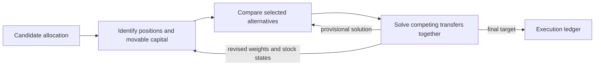

# RECAST | Portfolio management on Full US equities

RECAST learns how to allocate capital across a large stock universe. Once the model proposes a portfolio, a stock comparison has a concrete purpose. An alternative might improve a position that ties up substantial capital, while two appealing transfers might compete for the same holding. RECAST uses the candidate portfolio to decide which comparisons to make and how much capital to move.

This repository contains the PyTorch implementation of RECAST (Refining Candidate Allocations through Structured Transfers), Full US training and replay, six ablations, and initial monthly encoder weights. You can run a portfolio decision on a CPU with synthetic inputs. Historical training and replay use data obtained through your own institutional WRDS account. [Full US data sources and download instructions](docs/data-access.md)

## Quickstart

Use Python 3.12. Clone the repository and create a virtual environment.

```sh
git clone https://github.com/Sergio123-aguero/RECAST-Full-US.git
cd RECAST-Full-US
python -m venv .venv
```

Activate the environment with `.\.venv\Scripts\Activate.ps1` in PowerShell or `source .venv/bin/activate` in Bash. For a CPU installation on Linux or Windows, run the commands below. For a CUDA build, use the installation command for your GPU in the [PyTorch installation guide](https://pytorch.org/get-started/locally/).

```sh
python -m pip install torch --index-url https://download.pytorch.org/whl/cpu
python -m pip install -r training/requirements.txt
python training/train.py check-model
python training/smoke_forward.py
python evaluation/replay_full_us.py --policy-smoke
```

`check-model` constructs RECAST with the initial monthly encoder weights. The forward example prints candidate and final weights for 12 synthetic stocks. The ledger check exercises fills, fees and borrowing costs on synthetic orders.

## How a decision is made

Each stock contributes 252 trading days of 71 daily features and 24 months of 51 monthly features. Two 12-month windows share a monthly encoder. Their contribution to the daily representation depends on the coverage of the monthly inputs.



Shared summaries give each request a view of the stock universe. Requests share a budget for detailed comparisons. The joint solver accounts for proposals that draw on the same position. Its provisional solution guides the next comparisons within a round. Accepted transfers update both the allocation and the stocks' relational states for the next round. Only the final target goes to the execution ledger. [Model implementation](training/src/alphaportfolio_pcrr/dq_v1/model.py) · [Full US configuration](training/recast.json)

## Historical data and evaluation periods

Obtain the historical data under your institution's WRDS agreements and prepare the feature, execution and valuation inputs locally. The data guide covers source tables, date coverage, feature construction and the required directory layout. [Obtaining and preparing the data](docs/data-access.md)

If your licensed inputs are in the `shared/` and test-transfer layouts, assemble them in a new directory and verify them against their local manifests.

```sh
python data_tools/materialize_full_us_inputs.py --training-shared /path/to/shared --test-transfer /path/to/test-transfer --out data
python data_tools/verify_full_us_data.py --root data
```

The fixed research cohort contains 3,454 US stocks. Each day the model ranks the eligible stocks, forms its long and short candidates, and refines their weights under a shared capital budget. The ledger evaluates fill feasibility by date. The ledger continues to value an existing position when it leaves the eligible set.

| Period | Role |
| --- | --- |
| 2016–2017 | Fit the daily model on full trading paths. |
| 2018–2020 | Evaluate saved weights and select the update with the highest validation net Sharpe. |
| 2021–2025 | Replay the selected weights over 1,253 trading sessions. |

## Train and replay

Initialize the monthly temporal encoder from the supplied weights and train the entire daily policy jointly. The objective combines net Sharpe, annualized log growth (weight 0.25), and auxiliary losses for the refinement mechanism. AdamW uses a learning rate of `1e-4` in each parameter group, zero weight decay and gradient-norm clipping at 5.

```sh
python training/train.py train --variant recast --seed 7 --device cuda --output runs/full_us
python evaluation/replay_full_us.py --variant recast --run-dir runs/full_us --device cuda --output runs/full_us_test
```

For the paper's five-seed protocol, repeat the commands with five distinct seeds and separate output directories. Each run saves and validates a checkpoint after each of 100 full-path updates. Replay selects the highest validation net Sharpe for that seed and freezes the selected weights for testing. [Replay commands and execution assumptions](evaluation/README.md)

## Ablations

The Full US ablations cover the candidate allocation, three refinement mechanisms and two sources of representation. Each ablation uses the same Full US portfolio configuration and execution ledger. Each command trains the selected variant from initialization and applies the same validation and replay procedure. [Paper labels, command-line names and usage](ablations/README.md)

## Development and license

Run `python -m pytest tests -q` to check checkpoint selection, the model variants and replay metrics. To report a problem, include the command, model variant, Python and PyTorch versions, and a minimal example. [Public issue tracker](https://github.com/Sergio123-aguero/RECAST-Full-US/issues)

The software is released under the [MIT License](LICENSE). Access to and redistribution of financial data are governed by the applicable WRDS, CRSP and Compustat agreements.
